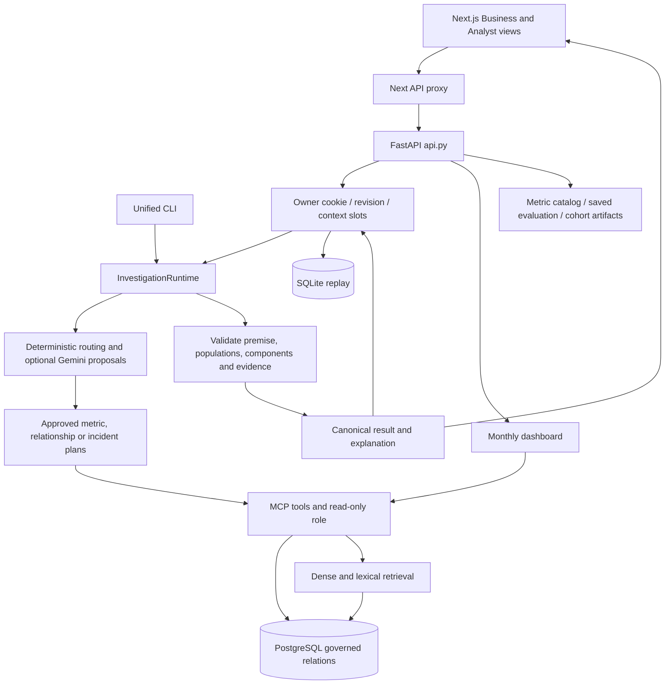

# Architecture and execution flow

The active product is a local Next.js application backed by FastAPI. The unified CLI and API share the investigation runtime in scripts/phase5_1_playground.py. Phase numbers describe implementation history. Several playground and assessor modules are imported during normal HTTP requests.

1. frontend/app/api/[...path]/route.ts forwards the request, owner cookie and origin to the configured API. frontend/lib/investigation-session.ts creates or restores the server session and sends the observed revision. The API checks origin on mutations, owner, expiry and revision. Stateless callers can post the question alone.
2. api.py also serves GET health (liveness), overview (saved evaluation), metrics (catalog and compiler registration), evidence (catalog and assessed artifacts), and dashboard (live readings). Session create, fetch, delete and saved-run replay are separate routes. dashboard_api.load_dashboard compares a selected calendar month with its predecessor. It discovers available sources and compiles six KPI readings separately for each period.
3. For a turn, agent/session_context.py resolves explicit corrections, inherited slots and clarification before dispatch. scripts/phase5_1_playground.py opens an MCP client and constructs the finance, graph, language and recovery components. InvestigationRuntime starts a budgeted investigation, dispatches explicit seller/refund and cross-domain requests or invokes the unified recovery/finance/graph routes. Optional model calls propose interpretations. Domain validators and app-owned compilers determine executable work.
4. mcp_server/server.py exposes domain/schema discovery, relation description, metric listing/definition, SQL reads and knowledge search. runtime_tools.py parses PostgreSQL SQL with SQLGlot, checks physical relations, wraps a row cap and uses a pooled SQLAlchemy engine with read-only transactions and timeouts. retrieval/hybrid.py combines embedding and lexical candidates and ranks document chunks. Document corroboration is a separate step after a governed reading.
5. Phase 4B supplies semantic maps, approved relationships, finance period compilers and reconciliation. Phase 4C supplies domain routing, accounting components, hypotheses, satisfaction, delivery and product metrics, aliases and clarification. Phase 5 joins bounded routes, handles incidents, and attaches exact-period cohort evidence. Seller and refund concentration modules implement additional scoped follow-ups. Earlier phase 3 graph/intent/provider modules and playgrounds also have standalone command paths. The API does not use each historical graph sequentially.
6. agent/investigation_state.py controls investigation work and records stop conditions. agent/investigation_result.py archives validated steps, preserves numeric encodings and builds the versioned envelope. Explanations distinguish measurements, hypotheses and limitations. Errors can retain partial evidence. investigation_sessions.py maintains bounded process-local history and latest usable context. investigation_traces.py stores redacted, checksummed snapshots for replay without a second model or database call.

## Data and operational ownership

docker-compose.yml provisions PostgreSQL with pgvector and mounts db/init on first initialization. db/migrations contains canonical views and finance components. sql/ includes domain-specific view creation, grants, independent reconciliation and role checks. finance_view_definition.sql is a view-definition excerpt. Raw, processed and synthetic data serve different stages. data/eval_ground_truth is evaluator-only. Olist orders and GA4 sessions are separate populations. reports/ contains historical evaluation artifacts, while selected root audit JSONs are executable inputs to assessors. config/ holds the catalog, semantic map, metric candidates and canonical response schema. frontend/tests and scripts/ contain separate presentation, contract, fixture and live evaluation paths.

The inventory below records locally declared Python entry points and direct project imports. Imports inside functions are included. Dynamic dispatch, MCP registration, SQL artifacts, CLIs and frontend references require the execution-flow interpretation above.

### HTTP and session adapters

- `api.py` — Local API adapter for the existing bounded OpsLens investigator. Local imports: agent.investigation_result, agent.phase4b2_metric_governance, agent.phase4c11_satisfaction, agent.phase4c15_delivery, agent.phase4c19_product, agent.phase5_2c_three_domain, agent.phase5_2e_multidomain_router, agent.session_context, dashboard_api, investigation_sessions, investigation_traces, scripts.phase5_1_playground, scripts.phase5_2b_assess, scripts.phase5_2d_assess.
- `dashboard_api.py` — Thin monthly dashboard adapter over existing governed metric compilers. Local imports: agent.phase4b1_semantic_playground, agent.phase4b2_metric_governance, agent.phase4c11_satisfaction, agent.phase4c15_delivery, mcp_server.server.
- `investigation_sessions.py` — Bounded process-local session persistence; owner credentials are not enterprise auth.
- `investigation_traces.py` — Bounded local audit snapshots. Replay is retrieval, never execution.

### agent

- `agent/__init__.py` — Package marker or module-level command.
- `agent/delivery_review_comparison.py` — Fixed read-only order-cohort comparison. Model text never becomes SQL. Local imports: agent.investigation_result, agent.phase4c15_delivery.
- `agent/delivery_review_routing.py` — Bounded routing slots; all execution uses the fixed comparison compiler. Local imports: agent.delivery_review_comparison, agent.phase4c27a_interpreter, agent.session_context.
- `agent/document_corroboration.py` — Document passages are untrusted data, never instructions or causal proof. Local imports: agent.investigation_state, retrieval.hybrid.
- `agent/evidence.py` — EvidenceAssessment, _pct, assess_cogs_vs_revenue, assess_profitability_pattern Local imports: agent.state.
- `agent/evidence_followup.py` — Evidence-conditioned extensions of registered operations; never model SQL. Local imports: agent.investigation_state, agent.phase4c11_satisfaction, agent.phase4c15_delivery, agent.refund_concentration, agent.seller_concentration.
- `agent/graph.py` — _initial_hypotheses, initialize_investigation, build_plan, select_next_hypothesis, evidence_sufficiency, finalize Local imports: agent.state.
- `agent/graph_phase3b.py` — initialize, plan_tests, execute_tests, evaluate_evidence, decide_stop, finalize Local imports: agent.evidence, agent.mcp_bridge, agent.planner, agent.state.
- `agent/graph_phase3c.py` — _pct, initialize, gather_structured_evidence, gather_document_evidence, _eval_monthly_growth, fuse_evidence Local imports: agent.evidence, agent.graph_phase3b, agent.mcp_bridge, agent.retrieval_phase3c, agent.schema_adaptive, agent.state.
- `agent/graph_phase3e.py` — EvidenceRequest, IntegratedState, initialize, route_request, _call_mcp, execute_structured Local imports: mcp_server.server.
- `agent/graph_phase3f.py` — DynamicState, _call_mcp, understand_question, plan_next, route_next, execute_action Local imports: agent.intent_phase3f, agent.policy_phase3f, mcp_server.server.
- `agent/intent_phase3f.py` — ParsedQuestion, _contains_any, parse_question
- `agent/investigation_result.py` — Versioned, lossless transport contract; serialization grants no evidence authority.
- `agent/investigation_state.py` — Request-local execution budgets shared by existing governed coordinators.
- `agent/investigator_phase3g.py` — LLMPlannerInvestigator Local imports: agent.graph_phase3f, agent.intent_phase3f, agent.planner_providers, agent.proposal_compiler.
- `agent/mcp_bridge.py` — OpsLensMCPBridge, run_sql_evidence Local imports: mcp_server.server.
- `agent/phase4a1_live_context.py` — Fail-closed MCP metadata adapter for Phase 4A context building. Local imports: agent.phase4a_context, mcp_server.server.
- `agent/phase4a_context.py` — Budgeted, allowlisted context assembly. No evaluator truth or raw document text.
- `agent/phase4a_plan_contract.py` — Schema and application-side validation of new, question-specific investigation plans. Local imports: agent.phase4a_context.
- `agent/phase4a_planner.py` — Offline baseline and Gemini for context-grounded plan drafting, not execution. Local imports: agent.phase4a_context, agent.phase4a_plan_contract.
- `agent/phase4b1_semantic_playground.py` — Interactive guarded SQL analysis, no causal inference or hidden truth access. Local imports: agent.phase4b1_semantic_query, mcp_server.server.
- `agent/phase4b1_semantic_query.py` — Conservative, metadata-checked single-relation query compiler.
- `agent/phase4b2_metric_governance.py` — Phase 4B.2: fail-closed business metrics, validated against live MCP columns. Local imports: agent.phase4b1_semantic_query.
- `agent/phase4b2_metric_playground.py` — Phase 4B.2 metric-first CLI; deliberately refuses unsupported metrics/joins. Local imports: agent.phase4b1_semantic_playground, agent.phase4b2_metric_governance, mcp_server.server.
- `agent/phase4b3_relationship_governance.py` — Phase 4B.3: approved analytical relationship contracts; no model-authored SQL. Local imports: agent.phase4b1_semantic_query.
- `agent/phase4b3_relationship_playground.py` — Interactive Phase 4B.3 governed relationships preview. No arbitrary joins. Local imports: agent.phase4b1_semantic_playground, agent.phase4b3_relationship_governance, mcp_server.server.
- `agent/phase4b41_live_verifier.py` — Read-only MCP checks of semantic-map contracts. Does NOT grant execution permissions. Local imports: mcp_server.server.
- `agent/phase4b42_relationship_auditor.py` — Phase 4B.4.2: read-only semantic relationship verification; never grants execution rights. Local imports: agent.phase4b41_live_verifier, mcp_server.server.
- `agent/phase4b43_graph_planner.py` — OpsLens 4B.4.3: graph-based, metric-grain-aware read-only query compiler. Local imports: agent.phase4b4_semantic_map.
- `agent/phase4b44_context_grounding.py` — Phase 4B.4.4: constrained natural-language -> semantic graph requests. Local imports: agent.phase4b43_graph_planner.
- `agent/phase4b44_gemini_interpreter.py` — Gemini parses only structured semantic intent, not SQL or execution permissions. Local imports: agent.phase4b44_context_grounding, investigation_traces.
- `agent/phase4b44_nl_playground.py` — Interactive natural-language semantic grounding + graph compiler + MCP. Local imports: agent.phase4b1_semantic_playground, agent.phase4b43_graph_planner, agent.phase4b44_context_grounding, agent.phase4b44_gemini_interpreter, mcp_server.server.
- `agent/phase4b45_nl_playground.py` — Phase 4B.4.5: natural-language graph playground with coverage and result safeguards. Local imports: agent.phase4b1_semantic_playground, agent.phase4b43_graph_planner, agent.phase4b44_context_grounding, agent.phase4b44_gemini_interpreter, agent.phase4b45_result_validation, mcp_server.server.
- `agent/phase4b45_result_validation.py` — Phase 4B.4.5: conservative evidence/result validation for graph analyses. Local imports: agent.phase4b43_graph_planner.
- `agent/phase4b4_semantic_map.py` — Phase 4B.4 semantic-map foundation: discovery, compatibility, fail-closed execution gate.
- `agent/phase4b51_metric_contracts.py` — Versioned, non-executable semantic metric contract repair candidates.
- `agent/phase4b52_reconciliation.py` — Phase 4B.5.2: read-only, multi-period semantic metric reconciliation.
- `agent/phase4b53_eligibility.py` — Observed financial population validation, not a general recognition policy.
- `agent/phase4b54_governed_finance.py` — Finance-only governed execution candidate. No LLM SQL or join permission. Local imports: agent.phase4b43_graph_planner.
- `agent/phase4b55_semantic_bridge.py` — Additive semantic routing for finance + existing graph metrics. Local imports: agent.phase4b43_graph_planner, agent.phase4b54_governed_finance.
- `agent/phase4b56_dynamic_period.py` — On-demand period reconciliation, separate from metric/dimension approval. Local imports: agent.investigation_result, agent.phase4b43_graph_planner, agent.phase4b53_eligibility, agent.phase4b54_governed_finance.
- `agent/phase4b57_nl_dynamic_finance.py` — Phase 4B.5.7: constrained NL finance intent -> audited dynamic totals. Local imports: agent.phase4b1_semantic_playground, agent.phase4b54_governed_finance, agent.phase4b56_dynamic_period, investigation_traces.
- `agent/phase4b5_semantic_expansion.py` — Phase 4B.5: semantic catalog audit and candidate gating (no database writes).
- `agent/phase4b_investigation_playground.py` — OpsLens Phase 4B: conservative, read-only investigation playground. Local imports: agent.phase4a1_live_context, agent.phase4a_plan_contract, agent.phase4a_planner, agent.phase4b_playground_utils, mcp_server.server.
- `agent/phase4b_playground_utils.py` — InvestigationUnavailable, month_window, previous_month, require_identifiers, num
- `agent/phase4c10_contract.py` — Fail-closed validator for review order-grain audit; no MCP authorization.
- `agent/phase4c11_satisfaction.py` — Governed, purchase-cohort satisfaction metrics from audited order-review view. Local imports: agent.investigation_result.
- `agent/phase4c12_cx_nlp.py` — Bounded Gemini semantic grounding for approved satisfaction metrics. Local imports: agent.phase4c11_satisfaction.
- `agent/phase4c13_cx_compare.py` — Governed two-period customer-satisfaction comparisons; no new SQL privileges. Local imports: agent.phase4c11_satisfaction, agent.phase4c12_cx_nlp.
- `agent/phase4c14_delivery_audit.py` — Phase 4C.14 audit gate: no MCP metric authorization; deterministic fail-closed evidence checks.
- `agent/phase4c15_delivery.py` — Governed delivery metrics: audited order grain, purchase-time cohorts, no causal claims. Local imports: agent.investigation_result.
- `agent/phase4c16_delivery_nlp.py` — Conservative delivery NLP router over audited Phase 4C.15 metric executor. Local imports: agent.phase4c12_cx_nlp, agent.phase4c13_cx_compare, agent.phase4c15_delivery.
- `agent/phase4c17_delivery_compare.py` — Governed delivery purchase-month comparisons: no new SQL contracts/permissions. Local imports: agent.phase4c15_delivery, agent.phase4c16_delivery_nlp.
- `agent/phase4c19_product.py` — Governed product/category descriptive metrics; requires separately approved view access. Local imports: agent.investigation_result.
- `agent/phase4c1_router.py` — Phase 4C.1: audited, capability-scoped request routing. No LLM-authored SQL. Local imports: agent.phase4b57_nl_dynamic_finance, investigation_traces.
- `agent/phase4c20_product_nlp.py` — Conservative, bounded product NLP backed solely by the governed 4C19 executor. Local imports: agent.phase4c19_product.
- `agent/phase4c21_category_catalog.py` — Evidence-audited product categories. No guessed translations, no automatic approvals.
- `agent/phase4c21b_aliases.py` — Human-reviewed, catalog-backed aliases; no guessed translations or SQL. Local imports: agent.phase4c21_category_catalog.
- `agent/phase4c24_language.py` — Conservative pre-routing language normalization. No SQL, no data-side permissions.
- `agent/phase4c25_clarification.py` — Stateful, opt-in clarification in front of Phase 4C.24 LanguageSession.
- `agent/phase4c26_recovery.py` — Bounded clarification recovery over 4C.25; no authorization changes. Local imports: agent.phase4b57_nl_dynamic_finance, agent.phase4c25_clarification.
- `agent/phase4c27a_interpreter.py` — Gemini-assisted interpretation ONLY; never authorizes or executes a tool.
- `agent/phase4c2_graph_routing.py` — Phase 4C.2 additive graph-analytics execution route, no new SQL permissions. Local imports: agent.investigation_result, agent.phase4b43_graph_planner, agent.phase4b44_context_grounding, agent.phase4c1_router.
- `agent/phase4c3_investigation.py` — Phase 4C.3: conservative, governed, multi-metric investigation workflow. Local imports: agent.phase4b56_dynamic_period, agent.phase4b57_nl_dynamic_finance.
- `agent/phase4c4_drivers.py` — Governed cost-driver reconciliation for Phase 4C.3 investigations. Local imports: agent.investigation_result, agent.phase4b56_dynamic_period.
- `agent/phase4c5_hypotheses.py` — Phase 4C.5: governed, evidence-driven hypothesis evaluation.
- `agent/phase4c6_nl_investigation.py` — Phase 4C.6: Natural-language investigation handoff to governed 4C.3-4C.5. Local imports: agent.phase4b56_dynamic_period, agent.phase4c3_investigation, agent.phase4c4_drivers, agent.phase4c5_hypotheses.
- `agent/phase4c6_unified_dispatch.py` — Additive routing hook: natural-language investigation + existing finance and graph. Local imports: agent.phase4c1_router, agent.phase4c2_graph_routing, agent.phase4c6_nl_investigation.
- `agent/phase4c7_adaptive.py` — Phase 4C.7 bounded, evidence-directed investigation coordinator. Local imports: agent.phase4c3_investigation, agent.phase4c4_drivers, agent.phase4c5_hypotheses, agent.phase4c6_nl_investigation.
- `agent/phase4c7_unified_dispatch.py` — Upgrade only investigation dispatch; preserve Phase4C.6 finance/graph state. Local imports: agent.phase4c1_router, agent.phase4c2_graph_routing, agent.phase4c7_adaptive.
- `agent/phase4c8_capabilities.py` — Phase 4C.8 capability registry. Descriptive metadata; NEVER grants SQL authorization.
- `agent/phase4c8_planning.py` — Deterministic, fail-closed bounded planning based on registered semantics. Local imports: agent.phase4c8_capabilities.
- `agent/phase4c8_unified_dispatch.py` — Discovery preflight for the existing Phase 4C.7 unified dispatcher. Local imports: agent.phase4c1_router, agent.phase4c7_unified_dispatch, agent.phase4c8_planning.
- `agent/phase4c9_operational_audit.py` — Fail-closed validation of read-only CX/delivery source audits.
- `agent/phase5_1_explanation.py` — Optional Gemini post-evidence explanation selector.
- `agent/phase5_1_unified.py` — Phase 5.1 bounded, opt-in Gemini interpretation bridge. Local imports: agent.phase4c25_clarification, agent.phase4c27a_interpreter.
- `agent/phase5_2_multidomain.py` — Phase 5.2: bounded delivery + satisfaction two-month investigator. Local imports: agent.phase4c11_satisfaction, agent.phase4c15_delivery.
- `agent/phase5_2c_three_domain.py` — Bounded finance + delivery + satisfaction investigation. No new SQL permissions. Local imports: agent.phase4c11_satisfaction, agent.phase4c15_delivery, agent.phase5_2_multidomain.
- `agent/phase5_2e_multidomain_router.py` — Phase 5.2E: bounded three-domain routing adapter for the unified OpsLens CLI. Local imports: agent.phase5_2c_three_domain, agent.phase5_2f_cohort_evidence.
- `agent/phase5_2f_cohort_evidence.py` — Explicit, independently assessed cohort evidence for descriptive reports. Local imports: scripts.phase5_2b_assess, scripts.phase5_2d_assess.
- `agent/phase5_3c_incident_gateway.py` — Phase 5.3C: failure-aware, bounded investigation planning. Local imports: agent.phase4c11_satisfaction, agent.phase4c15_delivery.
- `agent/planner.py` — PlannedTest, DeterministicBaselinePlanner
- `agent/planner_contract.py` — PlannerDecision
- `agent/planner_gemini.py` — GeminiPlannerProvider Local imports: agent.planner_contract, agent.planner_providers.
- `agent/planner_providers.py` — PlannerProvider, FakePlannerProvider, OpenAIResponsesPlannerProvider, make_planner_provider Local imports: agent.planner_contract.
- `agent/policy_phase3f.py` — NextAction, _pick, DynamicInvestigationPolicy
- `agent/proposal_compiler.py` — ProposalRejected, _e, validate_proposal, compile_proposal Local imports: agent.planner_contract, agent.policy_phase3f.
- `agent/refund_concentration.py` — Purchase-cohort returns and exclusive-seller refund concentration. Local imports: agent.investigation_result, agent.phase4c15_delivery.
- `agent/refund_routing.py` — contextual Local imports: agent.session_context.
- `agent/retrieval_phase3c.py` — RankedDocument, _quote_sql_literal, _looks_like_prompt_injection, rank_document, search_documents, supplier_cost_relevant Local imports: agent.mcp_bridge.
- `agent/schema_adaptive.py` — relation_columns, first_present, monthly_metric Local imports: agent.mcp_bridge.
- `agent/seller_concentration.py` — Exclusive single-seller order cohorts; no allocation of shared orders. Local imports: agent.investigation_result, agent.phase4c15_delivery.
- `agent/seller_routing.py` — contextual Local imports: agent.session_context.
- `agent/session_context.py` — Narrow contextual slots over RecoverySession, not free-form model memory. Local imports: agent.delivery_review_routing, agent.phase4c25_clarification, agent.phase4c26_recovery, agent.phase5_1_unified, agent.refund_routing, agent.seller_routing.
- `agent/state.py` — HypothesisStatus, EvidenceStrength, EvidenceItem, Hypothesis, InvestigationPlanItem, InvestigationState

### mcp_server

- `mcp_server/__init__.py` — Package marker or module-level command.
- `mcp_server/runtime_tools.py` — ToolResult, load_metric_catalog, discover_domains_impl, discover_schema_impl, describe_relation_impl, list_metrics_impl
- `mcp_server/server.py` — discover_domains, discover_schema, describe_relation, list_metrics, get_metric_definition, run_readonly_sql Local imports: mcp_server.runtime_tools, retrieval.hybrid.

### retrieval

- `retrieval/hybrid.py` — RetrievalHit, _model, _vector_literal, _injection_flag, _trust_boost, _freshness_boost Local imports: mcp_server.runtime_tools.
- `retrieval/mcp_extension.py` — search_knowledge Local imports: mcp_server.server, retrieval.hybrid.

### scripts

- `scripts/assign_incident_months.py` — month_floor, main
- `scripts/audit_and_clean_ga4_sessions.py` — first_non_null
- `scripts/audit_batch_a_incidents_v2.py` — main
- `scripts/audit_batch_b_business_impact_v3.py` — main
- `scripts/audit_batch_b_incidents.py` — main
- `scripts/audit_batch_c_incidents.py` — main
- `scripts/audit_business_layer.py` — pct, money, main
- `scripts/build_phase3d_index.py` — infer_source_date, chunk_text, vector_literal, main
- `scripts/calibrate_batch_b_v3_fixed.py` — month_floor, load_profitability, load_raw, calibrate_inc005, calibrate_inc006, calibrate_inc007
- `scripts/check_postgres.py` — Package marker or module-level command.
- `scripts/generate_batch_a_incidents_v5.py` — load_incident_months, stable_u01, month_floor, load_olist, choose_mature_month, generate_inc002
- `scripts/generate_batch_b_incidents_v2.py` — stable_u01, month_floor, load_olist, ensure_months_exist, load_profitability, generate_inc005
- `scripts/generate_batch_c_incidents.py` — write_doc, generate_inc009, generate_inc010, generate_inc011, generate_inc012, update_catalog
- `scripts/generate_business_layer.py` — stable_u01, month_floor, ensure_dirs, load_raw_olist, canonicalize, build_product_cost_history
- `scripts/inventory_data.py` — inspect_csv, inspect_excel, main
- `scripts/live_checkpoint.py` — Real MCP/database checkpoint. No mock data or model substitution. Local imports: agent.delivery_review_comparison, agent.evidence_followup, agent.investigation_result, agent.investigation_state, agent.phase4c3_investigation, agent.seller_concentration, mcp_server.server, scripts.phase5_1_playground.
- `scripts/live_checkpoint_validate.py` — GuardTests Local imports: agent.delivery_review_comparison, agent.delivery_review_routing, agent.seller_concentration, mcp_server.runtime_tools.
- `scripts/live_http_checkpoint.py` — Actual frontend-proxy HTTP journey; no monkeypatching or synthetic responses.
- `scripts/load_phase2b_v3.py` — paths_for, normalize_columns, load_csv, load_documents, assert_runtime_manifest_safe, staging_table_exists
- `scripts/merge_ga4_sessions.py` — Package marker or module-level command.
- `scripts/p0_1_validate.py` — P0.1 integrated routing and captured-evidence regressions; no external calls. Local imports: agent.phase4c20_product_nlp, agent.phase5_1_unified, agent.phase5_2e_multidomain_router, agent.phase5_3c_incident_gateway, scripts.phase4c19b_compare, scripts.phase4c19b_validate, scripts.phase5_3_eval, scripts.phase5_3b_incident_eval.
- `scripts/p0_2_capture.py` — Explicit read-only capture of real governed responses (never called by tests). Local imports: agent.investigation_result, agent.phase4b1_semantic_playground, agent.phase4b43_graph_planner, agent.phase4b44_context_grounding, agent.phase4b56_dynamic_period, agent.phase4b57_nl_dynamic_finance, agent.phase4c15_delivery, agent.phase4c2_graph_routing, agent.phase4c6_nl_investigation, agent.phase4c7_adaptive, agent.phase5_2c_three_domain, mcp_server.server.
- `scripts/p0_2_pdf_validate.py` — Independent PDF parser/layout checks after frontend/tests/export-pdf-qa.mjs.
- `scripts/p0_2_run_offline.py` — Run the applicable offline suites; retain per-suite output and exact totals.
- `scripts/p0_2_validate.py` — Lossless contract regressions: captured real results plus labeled executor cases. Local imports: agent.investigation_result, agent.phase4b1_semantic_playground, agent.phase4b43_graph_planner, agent.phase4c2_graph_routing, agent.phase4c3_investigation, agent.phase4c7_adaptive, agent.phase5_2_multidomain, agent.phase5_2c_three_domain, agent.phase5_2f_cohort_evidence, api, scripts.phase4c3_validate_investigation, scripts.phase4c4_validate_drivers, scripts.phase4c7_validate_adaptive, scripts.phase5_1_playground, scripts.phase5_2_validate, scripts.phase5_2d_assess.
- `scripts/p0_3_run_offline.py` — P0.3 regression matrix, including every P0.2 offline suite. Local imports: scripts.p0_2_run_offline.
- `scripts/p0_3_validate.py` — Actual FastAPI HTTP session tests with real recovery/executors and mocked MCP/model boundaries. Local imports: agent.phase4b1_semantic_playground, agent.phase4b43_graph_planner, agent.phase4b57_nl_dynamic_finance, agent.phase4c1_router, agent.phase4c25_clarification, agent.phase5_1_unified, agent.session_context, api, investigation_sessions, scripts.phase4b56_validate_dynamic, scripts.phase4c2_validate_routing, scripts.phase5_1_playground.
- `scripts/p1_1_validate.py` — Offline cohort contracts and actual HTTP integration; no live measurements. Local imports: agent.delivery_review_comparison, agent.delivery_review_routing, agent.phase4c15_delivery, api, investigation_sessions, scripts.p0_3_validate, scripts.p1_2_validate.
- `scripts/p1_2_validate.py` — Offline adaptive acceptance tests with real metric validators. Local imports: agent.delivery_review_comparison, agent.evidence_followup, agent.investigation_state, agent.phase4c7_adaptive, scripts.p0_3_validate, scripts.p1_1_validate, scripts.phase4c7_validate_adaptive.
- `scripts/p1_3_validate.py` — Offline seller contracts and real HTTP session integration. Local imports: agent.evidence_followup, agent.investigation_state, agent.phase4c15_delivery, agent.seller_concentration, agent.seller_routing, scripts.p0_3_validate, scripts.p1_2_validate.
- `scripts/p2_1_live.py` — Real HTTP/MCP/database document checkpoint; no fixtures or patched boundaries.
- `scripts/p2_1_validate.py` — Offline document claims plus captured repository passages and real HTTP routing. Local imports: agent.document_corroboration, agent.investigation_state, agent.phase4b1_semantic_playground, scripts.p0_3_validate.
- `scripts/p2_2_validate.py` — Focused trace persistence, HTTP replay and failure boundary tests; no live services. Local imports: agent.phase4b1_semantic_playground, api, investigation_traces, scripts.p0_3_validate.
- `scripts/p2_3_live.py` — Read-only live MCP verification, not a Gemini/HTTP journey. Local imports: agent.evidence_followup, agent.investigation_result, agent.investigation_state, agent.phase4b57_nl_dynamic_finance, agent.refund_concentration, investigation_traces, mcp_server.server.
- `scripts/p2_3_validate.py` — Refund correctness, adaptive behavior and actual HTTP/replay with mocked MCP. Local imports: agent.evidence_followup, agent.investigation_state, agent.phase4c15_delivery, agent.refund_concentration, agent.refund_routing, api, investigation_traces, mcp_server.runtime_tools, scripts.p0_3_validate.
- `scripts/phase2c_semantic_tools.py` — ToolResult, load_metric_catalog, discover_domains, discover_schema, describe_relation, list_metrics
- `scripts/phase4b1_diagnose_query.py` — Inspect Phase 4B.1 failures without hiding nested async/MCP errors. Local imports: agent.phase4b1_semantic_playground.
- `scripts/phase4b1_validate_date_casts.py` — test Local imports: agent.phase4b1_semantic_query.
- `scripts/phase4b1_validate_semantic_queries.py` — check Local imports: agent.phase4b1_semantic_query.
- `scripts/phase4b2_validate_metrics.py` — expect, run, assert_contains Local imports: agent.phase4b2_metric_governance.
- `scripts/phase4b3_validate_relationships.py` — Run as: python -m scripts.phase4b3_validate_relationships Local imports: agent.phase4b3_relationship_governance.
- `scripts/phase4b41_validate_verifier.py` — main Local imports: agent.phase4b41_live_verifier.
- `scripts/phase4b41_verify_live_map.py` — Launch live, read-only semantic map audit through the existing MCP server. Local imports: agent.phase4b41_live_verifier.
- `scripts/phase4b42_validate_relationships.py` — run Local imports: agent.phase4b42_relationship_auditor.
- `scripts/phase4b42_verify_relationships.py` — Package marker or module-level command. Local imports: agent.phase4b42_relationship_auditor.
- `scripts/phase4b43_run_query.py` — Execute a semantic-map-compiled request via the existing read-only MCP server. Local imports: agent.phase4b1_semantic_playground, agent.phase4b43_graph_planner, mcp_server.server.
- `scripts/phase4b43_validate_planner.py` — assert_contains, ok, reject Local imports: agent.phase4b43_graph_planner.
- `scripts/phase4b44_validate_gemini_schema.py` — Regression: Gemini request serialization avoids additionalProperties; local model stays strict. Local imports: agent.phase4b44_context_grounding, agent.phase4b44_gemini_interpreter.
- `scripts/phase4b44_validate_grounding.py` — Offline regression tests. Does not claim live Gemini or database verification. Local imports: agent.phase4b43_graph_planner, agent.phase4b44_context_grounding, agent.phase4b4_semantic_map.
- `scripts/phase4b45_validate_results.py` — Run with python -m scripts.phase4b45_validate_results Local imports: agent.phase4b43_graph_planner, agent.phase4b45_result_validation.
- `scripts/phase4b4_inspect_map.py` — Inspect the map without invoking Gemini or PostgreSQL. Local imports: agent.phase4b4_semantic_map.
- `scripts/phase4b4_validate_semantic_map.py` — Offline tests using declarative map, no database or API usage. Local imports: agent.phase4b4_semantic_map.
- `scripts/phase4b51_validate_contracts.py` — run Local imports: agent.phase4b51_metric_contracts.
- `scripts/phase4b51_verify_live_metrics.py` — Read-only MCP verification; never promotes to execution approval. Local imports: agent.phase4b1_semantic_playground, agent.phase4b51_metric_contracts, mcp_server.server.
- `scripts/phase4b52_reconcile_live.py` — Run bounded multi-month reconciliation through the existing MCP boundary. Local imports: agent.phase4b1_semantic_playground, agent.phase4b52_reconciliation, mcp_server.server.
- `scripts/phase4b52_validate_reconciliation.py` — sample, run Local imports: agent.phase4b52_reconciliation.
- `scripts/phase4b53_reconcile_live.py` — Execute financial eligibility checks through the existing read-only MCP interface. Local imports: agent.phase4b1_semantic_playground, agent.phase4b53_eligibility, mcp_server.server.
- `scripts/phase4b53_validate_eligibility.py` — Deterministic offline checks; no external dependencies. Local imports: agent.phase4b53_eligibility.
- `scripts/phase4b54_finance_playground.py` — CLI for tightly scoped governed financial measurement/period comparisons. Local imports: agent.phase4b1_semantic_playground, agent.phase4b54_governed_finance, mcp_server.server.
- `scripts/phase4b54_validate_governed_finance.py` — Offline fail-closed regression checks with real report fixture structure. Local imports: agent.phase4b54_governed_finance.
- `scripts/phase4b55_semantic_bridge.py` — Opt-in governed semantic bridge. No modifications to earlier agent entrypoints. Local imports: agent.phase4b1_semantic_playground, agent.phase4b55_semantic_bridge, mcp_server.server.
- `scripts/phase4b55_validate_bridge.py` — No DB required; verifies finance dispatch and existing graph unchanged. Local imports: agent.phase4b54_governed_finance, agent.phase4b55_semantic_bridge.
- `scripts/phase4b56_dynamic_finance.py` — CLI: live four-query period reconciliation, then gated metric measurement via MCP. Local imports: agent.phase4b1_semantic_playground, agent.phase4b56_dynamic_period, mcp_server.server.
- `scripts/phase4b56_validate_dynamic.py` — fixtures, reject, test, assert_true Local imports: agent.phase4b53_eligibility, agent.phase4b56_dynamic_period.
- `scripts/phase4b571_validate_reliability.py` — Regression suite for Phase 4B.5.7.1; no network or DB. Local imports: agent.phase4b54_governed_finance, agent.phase4b57_nl_dynamic_finance.
- `scripts/phase4b572_validate_coverage.py` — Offline regression for empty-period classification, no Gemini or PostgreSQL. Local imports: agent.phase4b56_dynamic_period, agent.phase4b57_nl_dynamic_finance.
- `scripts/phase4b57_nl_finance.py` — Interactive Gemini -> governed dynamic finance, preserving context only on success. Local imports: agent.phase4b57_nl_dynamic_finance, mcp_server.server.
- `scripts/phase4b57_validate_nl.py` — Offline safety and control-flow checks; does not call Gemini or PostgreSQL. Local imports: agent.phase4b54_governed_finance, agent.phase4b57_nl_dynamic_finance.
- `scripts/phase4b5_audit_catalog.py` — Run from project root: python -m scripts.phase4b5_audit_catalog Local imports: agent.phase4b5_semantic_expansion.
- `scripts/phase4b5_validate_catalog.py` — main Local imports: agent.phase4b5_semantic_expansion.
- `scripts/phase4b_validate_investigation.py` — Validation of safe date parsing and self-contained query preparation. Local imports: agent.phase4b_playground_utils.
- `scripts/phase4c10_assess.py` — Package marker or module-level command. Local imports: agent.phase4c10_contract.
- `scripts/phase4c10_validate.py` — check Local imports: agent.phase4c10_contract.
- `scripts/phase4c11_validate.py` — passes, rejected, run Local imports: agent.phase4c11_satisfaction.
- `scripts/phase4c11_validate_context_router.py` — Regression checks for deterministic period-only follow-up rescue; no Gemini/DB required. Local imports: agent.phase4b57_nl_dynamic_finance, agent.phase4c1_router.
- `scripts/phase4c11b_compare.py` — Compare live MCP output against separately run direct PostgreSQL audit JSON.
- `scripts/phase4c11b_live_mcp.py` — Live MCP smoke test for all governed satisfaction metrics. No permission mutations. Local imports: agent.phase4b57_nl_dynamic_finance, agent.phase4c11_satisfaction, mcp_server.server.
- `scripts/phase4c11b_validate.py` — passcheck, rejects Local imports: scripts.phase4c11b_compare.
- `scripts/phase4c12_unified_playground.py` — CX-aware unified playground; existing finance and graph dispatcher preserved. Local imports: agent.phase4b1_semantic_playground, agent.phase4b43_graph_planner, agent.phase4b44_gemini_interpreter, agent.phase4b57_nl_dynamic_finance, agent.phase4c12_cx_nlp, agent.phase4c1_router, agent.phase4c2_graph_routing, agent.phase4c6_nl_investigation, agent.phase4c8_unified_dispatch, mcp_server.server.
- `scripts/phase4c12_validate.py` — Offline, no network: deterministic grounding and independent-state guarantees. Local imports: agent.phase4c11_satisfaction, agent.phase4c12_cx_nlp.
- `scripts/phase4c12_validate_ambiguity.py` — Phase 4C.1.2: ambiguity, clarification, disagreement and safety regression. Local imports: agent.phase4b57_nl_dynamic_finance, agent.phase4c1_router.
- `scripts/phase4c13_unified_playground.py` — CX-aware unified playground; existing finance and graph dispatcher preserved. Local imports: agent.phase4b1_semantic_playground, agent.phase4b43_graph_planner, agent.phase4b44_gemini_interpreter, agent.phase4b57_nl_dynamic_finance, agent.phase4c13_cx_compare, agent.phase4c1_router, agent.phase4c2_graph_routing, agent.phase4c6_nl_investigation, agent.phase4c8_unified_dispatch, mcp_server.server.
- `scripts/phase4c13_validate.py` — Offline deterministic tests. Real MCP access must be tested separately. Local imports: agent.phase4c11_satisfaction, agent.phase4c12_cx_nlp, agent.phase4c13_cx_compare.
- `scripts/phase4c14_assess.py` — main Local imports: agent.phase4c14_delivery_audit.
- `scripts/phase4c14_validate.py` — Offline tampering and population checks for the delivery audit assessor. Local imports: agent.phase4c14_delivery_audit.
- `scripts/phase4c15_compare.py` — Compare independent June PostgreSQL totals with live MCP execution.
- `scripts/phase4c15_live_mcp.py` — Live MCP smoke check for four delivery metrics, fail closed. Local imports: agent.phase4b57_nl_dynamic_finance, agent.phase4c15_delivery, mcp_server.server.
- `scripts/phase4c15_validate.py` — Offline deterministic contract/negative tests for governed delivery metrics. Local imports: agent.phase4c15_delivery, scripts.phase4c15_compare.
- `scripts/phase4c16_unified_playground.py` — CX-aware unified playground; existing finance and graph dispatcher preserved. Local imports: agent.phase4b1_semantic_playground, agent.phase4b43_graph_planner, agent.phase4b44_gemini_interpreter, agent.phase4b57_nl_dynamic_finance, agent.phase4c16_delivery_nlp, agent.phase4c1_router, agent.phase4c2_graph_routing, agent.phase4c6_nl_investigation, agent.phase4c8_unified_dispatch, mcp_server.server.
- `scripts/phase4c16_validate.py` — check, test_ground, test_session Local imports: agent.phase4c15_delivery, agent.phase4c16_delivery_nlp.
- `scripts/phase4c17_unified_playground.py` — CX-aware unified playground; existing finance and graph dispatcher preserved. Local imports: agent.phase4b1_semantic_playground, agent.phase4b43_graph_planner, agent.phase4b44_gemini_interpreter, agent.phase4b57_nl_dynamic_finance, agent.phase4c17_delivery_compare, agent.phase4c1_router, agent.phase4c2_graph_routing, agent.phase4c6_nl_investigation, agent.phase4c8_unified_dispatch, mcp_server.server.
- `scripts/phase4c17_validate.py` — ok, main Local imports: agent.phase4c16_delivery_nlp, agent.phase4c17_delivery_compare.
- `scripts/phase4c18_assess.py` — Assess grounded, read-only product/category relationship evidence. No grants.
- `scripts/phase4c18_validate.py` — Deterministic contract tests; no database needed. Local imports: scripts.phase4c18_assess.
- `scripts/phase4c19_assess.py` — assess
- `scripts/phase4c19_policy_regression.py` — Regression for the product MCP query shape; no network or database required. Local imports: agent.phase4c19_product.
- `scripts/phase4c19_validate.py` — ok, reject, success, simulated Local imports: agent.phase4c19_product.
- `scripts/phase4c19b_compare.py` — Compare MCP product results with independent raw-table PostgreSQL June reconciliation.
- `scripts/phase4c19b_live_mcp.py` — Live read-only MCP verification of five registered product/category metrics. Local imports: agent.phase4b57_nl_dynamic_finance, agent.phase4c19_product, mcp_server.server.
- `scripts/phase4c19b_validate.py` — Offline checks for the Phase 4C.19B comparator (no database required). Local imports: agent.phase4c19_product, scripts.phase4c19b_compare.
- `scripts/phase4c1_router_playground.py` — Live routing demonstration. Finance queries use existing vetted MCP path. Local imports: agent.phase4b57_nl_dynamic_finance, agent.phase4c1_router, mcp_server.server.
- `scripts/phase4c1_validate_router.py` — Offline safety and integration tests: no Gemini key or database required. Local imports: agent.phase4b57_nl_dynamic_finance, agent.phase4c1_router.
- `scripts/phase4c20_unified_playground.py` — Product-aware unified interactive playground, retaining Phase 4C.17 dispatcher. Local imports: agent.phase4b1_semantic_playground, agent.phase4b43_graph_planner, agent.phase4b44_gemini_interpreter, agent.phase4b57_nl_dynamic_finance, agent.phase4c17_delivery_compare, agent.phase4c1_router, agent.phase4c20_product_nlp, agent.phase4c2_graph_routing, agent.phase4c6_nl_investigation, agent.phase4c8_unified_dispatch, mcp_server.server.
- `scripts/phase4c20_validate.py` — Offline tests for conservative product NLP routing and context. Local imports: agent.phase4c20_product_nlp.
- `scripts/phase4c21_assess.py` — CLI: python -m scripts.phase4c21_assess phase4c21_category_catalog.json Local imports: agent.phase4c21_category_catalog.
- `scripts/phase4c21_catalog_lookup.py` — CLI: python -m scripts.phase4c21_catalog_lookup CATALOG_JSON category name Local imports: agent.phase4c21_category_catalog.
- `scripts/phase4c21_sql_regression.py` — Static regression for previously unsupported FULL JOIN nullable category matching.
- `scripts/phase4c21_validate.py` — Offline fail-closed category census and exact-name resolver regression checks. Local imports: agent.phase4c21_category_catalog.
- `scripts/phase4c21b_review.py` — python -m scripts.phase4c21b_review template|validate|resolve CATALOG.json REVIEW.csv [ALIAS] Local imports: agent.phase4c21_category_catalog, agent.phase4c21b_aliases.
- `scripts/phase4c21b_validate.py` — fake, check, main, assert_eq Local imports: agent.phase4c21_category_catalog, agent.phase4c21b_aliases.
- `scripts/phase4c24_unified_playground.py` — Opt-in CLI using the existing 4C20 session and a language pre-router. Local imports: agent.phase4b1_semantic_playground, agent.phase4b43_graph_planner, agent.phase4b44_gemini_interpreter, agent.phase4b57_nl_dynamic_finance, agent.phase4c17_delivery_compare, agent.phase4c1_router, agent.phase4c20_product_nlp, agent.phase4c24_language, agent.phase4c2_graph_routing, agent.phase4c6_nl_investigation, agent.phase4c8_unified_dispatch, mcp_server.server.
- `scripts/phase4c24_validate.py` — Offline safeguards and integration tests without MCP or credentials. Local imports: agent.phase4c20_product_nlp, agent.phase4c24_language.
- `scripts/phase4c24b_validate.py` — Regression checks for single-pass, non-overlapping language normalization. Local imports: agent.phase4c24_language.
- `scripts/phase4c25_unified_playground.py` — Opt-in 4C.25 playground reusing the verified 4C.24 runtime. Local imports: agent.phase4b1_semantic_playground, agent.phase4b43_graph_planner, agent.phase4b44_gemini_interpreter, agent.phase4b57_nl_dynamic_finance, agent.phase4c17_delivery_compare, agent.phase4c1_router, agent.phase4c20_product_nlp, agent.phase4c24_language, agent.phase4c25_clarification, agent.phase4c2_graph_routing, agent.phase4c6_nl_investigation, agent.phase4c8_unified_dispatch, mcp_server.server.
- `scripts/phase4c25_validate.py` — Deterministic tests; no live DB, LLM or MCP needed. Local imports: agent.phase4c25_clarification.
- `scripts/phase4c26_unified_playground.py` — 4C.26 opt-in playground; reuses all 4C.25 execution wiring. Local imports: agent.phase4b1_semantic_playground, agent.phase4b43_graph_planner, agent.phase4b44_gemini_interpreter, agent.phase4b57_nl_dynamic_finance, agent.phase4c17_delivery_compare, agent.phase4c1_router, agent.phase4c20_product_nlp, agent.phase4c24_language, agent.phase4c26_recovery, agent.phase4c2_graph_routing, agent.phase4c6_nl_investigation, agent.phase4c8_unified_dispatch, mcp_server.server.
- `scripts/phase4c26_validate.py` — Standalone deterministic regression; no database, LLM or MCP access. Local imports: agent.phase4c26_recovery.
- `scripts/phase4c27a_smoke.py` — Optional live Gemini smoke test. Never executes MCP or domain queries. Local imports: agent.phase4c27a_interpreter.
- `scripts/phase4c27a_validate.py` — test, good, rejected, assert_status, make_client, async_valid Local imports: agent.phase4c27a_interpreter.
- `scripts/phase4c2_unified_playground.py` — OpsLens Phase 4C.2 unified finance + graph routing, read-only MCP. Local imports: agent.phase4b1_semantic_playground, agent.phase4b43_graph_planner, agent.phase4b44_gemini_interpreter, agent.phase4b57_nl_dynamic_finance, agent.phase4c1_router, agent.phase4c2_graph_routing, mcp_server.server.
- `scripts/phase4c2_validate_routing.py` — Offline end-to-end routing tests without LLM API, Docker or database. Local imports: agent.phase4b43_graph_planner, agent.phase4b44_context_grounding, agent.phase4c1_router, agent.phase4c2_graph_routing.
- `scripts/phase4c3_investigate.py` — Execute a governed investigation with explicitly supplied periods. Local imports: agent.phase4b57_nl_dynamic_finance, agent.phase4c3_investigation, mcp_server.server.
- `scripts/phase4c3_unified_playground.py` — Phase 4C.3: existing router + explicit-period governed investigation command. Local imports: agent.phase4b1_semantic_playground, agent.phase4b43_graph_planner, agent.phase4b44_gemini_interpreter, agent.phase4b57_nl_dynamic_finance, agent.phase4c1_router, agent.phase4c2_graph_routing, agent.phase4c3_investigation, mcp_server.server.
- `scripts/phase4c3_validate_investigation.py` — Offline deterministic contract tests; does not access database or Gemini. Local imports: agent.phase4c3_investigation.
- `scripts/phase4c4_investigate.py` — Run 4C.3 premise investigation, then 4C.4 governed cost discovery. Local imports: agent.phase4b57_nl_dynamic_finance, agent.phase4c3_investigation, agent.phase4c4_drivers, mcp_server.server.
- `scripts/phase4c4_validate_drivers.py` — Offline tests for Phase 4C.4 governed driver discovery. Local imports: agent.phase4c4_drivers.
- `scripts/phase4c5_investigate.py` — Phase 4C.5 live demo: audited core + verified components + ranked hypotheses. Local imports: agent.phase4b57_nl_dynamic_finance, agent.phase4c3_investigation, agent.phase4c4_drivers, agent.phase4c5_hypotheses, mcp_server.server.
- `scripts/phase4c5_validate_hypotheses.py` — Offline, deterministic regression suite for Phase 4C.5. Local imports: agent.phase4c5_hypotheses.
- `scripts/phase4c6_unified_playground.py` — Natural-language investigation integrated with finance and graph routes. Local imports: agent.phase4b1_semantic_playground, agent.phase4b43_graph_planner, agent.phase4b44_gemini_interpreter, agent.phase4b57_nl_dynamic_finance, agent.phase4c1_router, agent.phase4c2_graph_routing, agent.phase4c6_nl_investigation, agent.phase4c6_unified_dispatch, mcp_server.server.
- `scripts/phase4c6_validate_nl.py` — Offline contract tests for 4C.6; no Gemini, DB, or MCP required. Local imports: agent.phase4c1_router, agent.phase4c2_graph_routing, agent.phase4c6_nl_investigation, agent.phase4c6_unified_dispatch.
- `scripts/phase4c7_unified_playground.py` — Natural-language investigation integrated with finance and graph routes. Local imports: agent.phase4b1_semantic_playground, agent.phase4b43_graph_planner, agent.phase4b44_gemini_interpreter, agent.phase4b57_nl_dynamic_finance, agent.phase4c1_router, agent.phase4c2_graph_routing, agent.phase4c6_nl_investigation, agent.phase4c7_unified_dispatch, mcp_server.server.
- `scripts/phase4c7_validate_adaptive.py` — Offline validation of bounded 4C.7 planner (no Gemini, Postgres or MCP). Local imports: agent.phase4c6_nl_investigation, agent.phase4c7_adaptive.
- `scripts/phase4c8_discover.py` — Explore available and missing analytical capabilities without DB or LLM. Local imports: agent.phase4c8_capabilities, agent.phase4c8_planning.
- `scripts/phase4c8_unified_playground.py` — Natural-language investigation integrated with finance and graph routes. Local imports: agent.phase4b1_semantic_playground, agent.phase4b43_graph_planner, agent.phase4b44_gemini_interpreter, agent.phase4b57_nl_dynamic_finance, agent.phase4c1_router, agent.phase4c2_graph_routing, agent.phase4c6_nl_investigation, agent.phase4c8_unified_dispatch, mcp_server.server.
- `scripts/phase4c8_validate_capabilities.py` — Offline tests for 4C.8. No DB, Gemini or MCP required. Local imports: agent.phase4c8_capabilities, agent.phase4c8_planning.
- `scripts/phase4c9_assess_audit.py` — Read a single JSON audit object produced by phase4c9_cx_delivery_audit.sql. Local imports: agent.phase4c9_operational_audit.
- `scripts/phase4c9_validate_operational.py` — fixture, main, assert_true Local imports: agent.phase4c9_operational_audit.
- `scripts/phase5_1_playground.py` — Unified OpsLens CLI. --gemini is opt-in (calls actual API and costs tokens). Local imports: agent.delivery_review_comparison, agent.delivery_review_routing, agent.document_corroboration, agent.evidence_followup, agent.investigation_result, agent.investigation_state, agent.phase4b1_semantic_playground, agent.phase4b43_graph_planner, agent.phase4b44_gemini_interpreter, agent.phase4b56_dynamic_period, agent.phase4b57_nl_dynamic_finance, agent.phase4c17_delivery_compare, agent.phase4c1_router, agent.phase4c20_product_nlp, agent.phase4c24_language, agent.phase4c26_recovery, agent.phase4c27a_interpreter, agent.phase4c2_graph_routing, agent.phase4c6_nl_investigation, agent.phase4c7_adaptive, agent.phase4c8_unified_dispatch, agent.phase5_1_explanation, agent.phase5_1_unified, agent.phase5_2c_three_domain, agent.phase5_2e_multidomain_router, agent.phase5_2f_cohort_evidence, agent.phase5_3c_incident_gateway, agent.refund_concentration, agent.refund_routing, agent.seller_concentration, agent.seller_routing, agent.session_context, investigation_traces, mcp_server.server.
- `scripts/phase5_1_validate.py` — Offline integration gates; mock Gemini and downstream governed router. Local imports: agent.phase4c27a_interpreter, agent.phase5_1_unified.
- `scripts/phase5_1_validate_explanation.py` — Deterministic tests for Gemini's bounded post-evidence explanation selector. Local imports: agent.phase5_1_explanation.
- `scripts/phase5_1b_validate.py` — Standalone offline checks for 5.1B; no Gemini, DB or MCP required.
- `scripts/phase5_1c_validate.py` — Dependency-free focused regression for delivery comparison routing.
- `scripts/phase5_2_live.py` — Live governed MCP two-domain verification: no LLM, no new grants. Local imports: agent.phase4b57_nl_dynamic_finance, agent.phase5_2_multidomain, mcp_server.server.
- `scripts/phase5_2_validate.py` — Deterministic contract and fail-closed tests; no live credentials required. Local imports: agent.phase4c11_satisfaction, agent.phase4c15_delivery, agent.phase5_2_multidomain.
- `scripts/phase5_2b_assess.py` — Independent fail-closed check of Phase 5.2B cohort audit JSON.
- `scripts/phase5_2b_validate.py` — Offline audit contract regression tests; no DB needed. Local imports: scripts.phase5_2b_assess.
- `scripts/phase5_2c_live.py` — Live three-domain investigation; existing MCP reader and finance investigator only. Local imports: agent.phase4b57_nl_dynamic_finance, agent.phase4c6_nl_investigation, agent.phase4c7_adaptive, agent.phase5_2c_three_domain, mcp_server.server.
- `scripts/phase5_2c_validate.py` — Deterministic contract regression; no database or API required. Local imports: agent.phase5_2c_three_domain.
- `scripts/phase5_2d_assess.py` — Independent fail-closed check of Phase 5.2D cohort audit JSON.
- `scripts/phase5_2d_validate.py` — Offline contract and tamper regression tests for 5.2D. Does not connect to PostgreSQL. Local imports: scripts.phase5_2d_assess.
- `scripts/phase5_2e_validate.py` — Offline, fail-closed Phase 5.2E routing checks; no Gemini, DB or MCP.
- `scripts/phase5_2f_validate.py` — Offline audit attachment, negative fixtures, and no-authority regressions. Local imports: agent.phase5_2c_three_domain, agent.phase5_2f_cohort_evidence, scripts.phase5_2c_validate, scripts.phase5_2d_assess.
- `scripts/phase5_3_eval.py` — Phase 5.3A: reproducible, fail-closed OpsLens evaluation; no new authority. Local imports: agent.phase5_2e_multidomain_router.
- `scripts/phase5_3b_incident_eval.py` — Phase 5.3B: evidence-first incident benchmark, no new agent privileges.
- `scripts/phase5_3c_validate.py` — Deterministic offline regression tests for Phase 5.3C. No Gemini/MCP calls.
- `scripts/phase5_3d_validate.py` — Phase 5.3D offline regression; no DB / Gemini, mocks cannot certify live behavior. Local imports: agent.phase5_3c_incident_gateway, scripts.phase5_3b_incident_eval.
- `scripts/phase5_3e_final_gate.py` — OpsLens pre-UI release gate: evaluates observed reports, never invents live proof. Local imports: scripts.phase5_3b_incident_eval.
- `scripts/phase5_3e_validate.py` — Adversarial offline tests for pre-UI scoring and evidence-period contracts. Local imports: scripts.phase5_3b_incident_eval, scripts.phase5_3e_final_gate.
- `scripts/phase5_3f_pre_ui_review.py` — Read-only pre-UI evaluation review. No model, MCP, DB, or fixture execution.
- `scripts/phase5_3f_validate.py` — Deterministic negative and positive coverage for the Phase 5.3F review contract. Local imports: scripts.phase5_3f_pre_ui_review.
- `scripts/phase6_api_contract_validate.py` — Offline contract tests for the read-only API metadata and audit matching. Local imports: agent.phase4c11_satisfaction, agent.phase4c15_delivery, agent.phase4c19_product, agent.phase4c25_clarification, agent.phase5_2e_multidomain_router, api.
- `scripts/phase6_dashboard_validate.py` — Contract and rule checks for the monthly governed dashboard adapter. Local imports: dashboard_api.
- `scripts/regenerate_inc012_v2.py` — build_rows, main
- `scripts/setup_phase2d_runtime_role.py` — quote_ident, quote_literal, main
- `scripts/smoke_phase3g_gemini.py` — Package marker or module-level command. Local imports: agent.planner_gemini, agent.proposal_compiler.
- `scripts/smoke_phase3g_openai.py` — Package marker or module-level command. Local imports: agent.planner_providers.
- `scripts/smoke_phase4a1_gemini.py` — main Local imports: agent.phase4a1_live_context, agent.phase4a_planner.
- `scripts/smoke_phase4a_gemini.py` — Package marker or module-level command. Local imports: agent.phase4a_context, agent.phase4a_planner.
- `scripts/test_audit_cohorts.py` — test_independent_may_june_attachment Local imports: agent.phase5_2f_cohort_evidence, api.
- `scripts/test_audit_sql_boundary.py` — test_xml_access_cannot_hide_behind_approved_relation, test_approved_aggregate_still_passes Local imports: mcp_server.runtime_tools.
- `scripts/validate_phase2b.py` — add
- `scripts/validate_phase2d_mcp_v2.py` — main Local imports: mcp_server.server.
- `scripts/validate_phase3a.py` — main Local imports: agent.graph, agent.state.
- `scripts/validate_phase3b_v2.py` — Package marker or module-level command. Local imports: agent.graph_phase3b, agent.state.
- `scripts/validate_phase3c.py` — Package marker or module-level command. Local imports: agent.graph_phase3c, agent.state.
- `scripts/validate_phase3d.py` — main Local imports: retrieval.hybrid.
- `scripts/validate_phase3e.py` — validate_mcp_tools, main Local imports: agent.graph_phase3e, mcp_server.server.
- `scripts/validate_phase3e_imports.py` — Package marker or module-level command. Local imports: agent.graph_phase3e, mcp_server.server, retrieval.hybrid.
- `scripts/validate_phase3f.py` — run_case Local imports: agent.graph_phase3f.
- `scripts/validate_phase3g.py` — main Local imports: agent.investigator_phase3g, agent.planner_contract, agent.planner_providers, agent.proposal_compiler.
- `scripts/validate_phase3g_gemini.py` — main Local imports: agent.investigator_phase3g, agent.planner_gemini.
- `scripts/validate_phase4a.py` — add Local imports: agent.phase4a_context, agent.phase4a_plan_contract, agent.phase4a_planner.
- `scripts/validate_phase4a1_live.py` — main Local imports: agent.phase4a1_live_context.

### SQL inventory

- `db/init/001_extensions.sql`
- `db/init/002_schemas.sql`
- `db/migrations/010_phase2b_canonical_views.sql` — behavior.sessions, catalog.products, commerce.customers, commerce.order_items, commerce.orders, commerce.payments, cx.effective_reviews, cx.returns, cx.reviews, finance.daily_pnl, finance.order_profitability_base, finance.order_profitability_effective, inventory.effective_sales, inventory.stockout_events, inventory.weekly, knowledge.documents, marketing.campaigns, marketing.inc006_effective_economics, marketing.order_attribution, marketing.spend_daily, operations.delivery_effective, operations.sellers, semantic.daily_commerce, semantic.ga4_funnel_daily, semantic.misleading_correlation_fixture, semantic.order_economics, semantic.product_mix_effective, semantic.stockout_effective_sales, staging.cx_incident_overrides, staging.daily_pnl, staging.documents, staging.effective_delivery_dates, staging.ga4_sessions, staging.inc005_effective_mix_economics, staging.inc006_campaign, staging.inc006_effective_marketing_economics, staging.inc007_effective_sales, staging.inc012_misleading_correlation, staging.inventory_weekly, staging.marketing_campaigns, staging.marketing_spend_daily, staging.olist_customers, staging.olist_order_items, staging.olist_order_payments, staging.olist_order_reviews, staging.olist_orders, staging.olist_products, staging.olist_sellers, staging.order_campaign_attribution, staging.order_profitability, staging.product_category_translation, staging.regional_capacity_overrides, staging.returns, staging.stockout_events
- `db/migrations/011_phase4c4_cost_components.sql` — finance.order_profitability_effective, semantic.order_cost_components
- `finance_view_definition.sql` — staging.inc006_effective_marketing_economics, staging.order_profitability, staging.regional_capacity_overrides
- `sql/phase4c10_audit.sql` — commerce.orders, cx.effective_reviews, p.avg_score, p.n, p.scored, semantic.order_review_evidence_v1
- `sql/phase4c10_review_view.sql` — commerce.orders, cx.effective_reviews, semantic.order_review_evidence_v1
- `sql/phase4c11_approval_grant.sql`
- `sql/phase4c11_role_check.sql`
- `sql/phase4c11b_independent_reconciliation.sql` — semantic.order_review_evidence_v1
- `sql/phase4c14_delivery_audit.sql` — operations.delivery_effective, semantic.order_delivery_evidence_v1
- `sql/phase4c14_delivery_view.sql` — operations.delivery_effective, semantic.order_delivery_evidence_v1
- `sql/phase4c15_independent_june.sql` — semantic.order_delivery_evidence_v1
- `sql/phase4c15_role_check.sql`
- `sql/phase4c18_product_audit.sql` — catalog.products, commerce.order_items, commerce.orders
- `sql/phase4c19_item_evidence.sql` — catalog.products, commerce.order_items, commerce.orders, semantic.order_item_product_evidence_v1
- `sql/phase4c19_reconcile.sql` — catalog.products, commerce.order_items, commerce.orders, semantic.order_item_product_evidence_v1
- `sql/phase4c19_role_check.sql`
- `sql/phase4c19b_independent_june_health_beauty.sql` — catalog.products, commerce.order_items, commerce.orders
- `sql/phase4c21_category_catalog_audit.sql` — catalog.products, commerce.order_items
- `sql/phase4c9_cx_delivery_audit.sql` — commerce.orders, cx.effective_reviews, operations.delivery_effective
- `sql/phase5_2b_order_cohort_audit.sql` — commerce.orders, d.purchase_ts, r.purchase_ts, semantic.order_delivery_evidence_v1, semantic.order_review_evidence_v1
- `sql/phase5_2d_order_cohort_audit.sql` — commerce.orders, d.purchase_ts, r.purchase_ts, semantic.order_delivery_evidence_v1, semantic.order_review_evidence_v1
